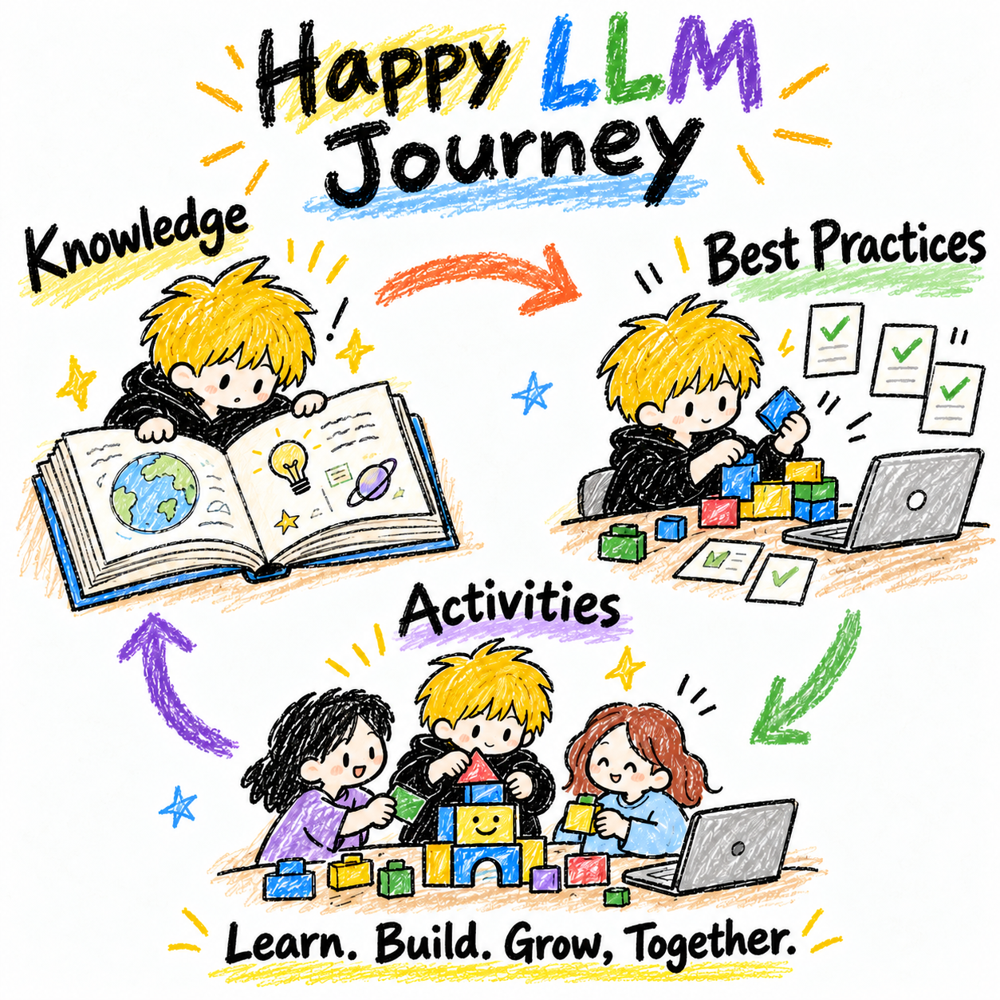

**English** | [简体中文](GUIDE.zh-CN.md)



- [Learning](knowledge/README.md): Build engineering and algorithm knowledge, understand principles, and look things up as needed.
- [Best Practices](practices/README.md): Distill real experience and help readers develop their own methods or Skills.
- [Activities](activities/README.md): Apply methods to tasks, learning, checking results, and improving through practice.

[Browse the content](https://happy-llm.anjing.cc) · [GitHub Pages](https://anjing-le.github.io/happy-llm-journey/)

The linked learning materials and website currently remain primarily in Chinese. These two READMEs provide bilingual project introductions, not a fully translated course.

## How to use

- **Read directly**: Open the content overview above and select an entry.
- **Use an article**: Copy its full text from the entry or reading window, then give it to an Agent along with your goal. Copied content includes sources and accessible reference links.
- **Start from the repository**: Use the website's “Hand to Agent” entry, or copy this prompt:

```text
Read the README and AGENTS.md at https://github.com/anjing-le/happy-llm-journey.
Follow the "Using the content" instructions to help me with: <your goal>.
```

<a id="目标"></a>
## Goal

Codex bridges this repository and its users: it reads relevant content, understands the user's goals, background and situation, then helps them join suitable activities, apply practices and learn knowledge as needed. Users need not understand the internal directory structure first. Sources, conditions and validation status remain available.

Knowledge supplies understanding and evidence. Guidance explains how to understand users, adapt methods, produce results and verify them. For example, [vibe coding](practices/codex-vibe-coding.md) helps readers develop personal methods around their projects and habits, create a Skill when useful, and improve it through real tasks. Reading an article does not authorize installation or execution.

## Maintenance rules

- **Workflow**: Follow [AGENTS.md](AGENTS.md) to connect framework design, individual content improvements and user feedback in one task. For activities, consult the [shared principles](activities/DESIGN.md).
- **Handoffs**: Keep goals, entry files, actual progress and next steps in the backlog below so another device, task or contributor can continue.
- **Organization**: Maintain each piece of content as one Markdown source, connected with relative links. Knowledge covers engineering and algorithms. Start with flat entries and practice lists; organize further as needed. Do not bulk-generate textbooks or import historical material indiscriminately.
- **Writing**: Prefer short paragraphs and lists; keep shared rules in one place. Begin content with purpose and current status; guidance should explain usage. Separate facts, inferences and experience; preserve sources, conditions, evidence and limitations. Drafts are not verified practices.
- **Attribution**: Articles identify original or co-created work, authors and links below their titles, with the type confirmed by the author or user. Navigation, plans and templates are not articles.
- **Public boundaries**: Exclude company-internal material, credentials, personal information, private reviews and hidden answers. Personalized information stays in the user's environment. Feed back common lessons only with authorization and de-identification.
- **Website source**: The `web/` build reads project and module Markdown to generate navigation, descriptions and reading pages. Do not maintain a second body of content or edit generated files. See [AGENTS.md](AGENTS.md).

## Development and publishing

Content and the frontend share this repository: the three modules contain Markdown; `web/` contains React, TypeScript and Vite. Node.js 22.12+ is required.

The site follows Happy GitHub Journey's simple layout: Learning, Best Practices and Activities in three columns, with collapsible navigation, hover descriptions and articles in reading dialogs. Mobile uses top tabs to show one column at a time. Article rows and reading windows support copying full text; reading windows also offer link copying and original Markdown. Manual copying is available when automatic copying fails. The website homepage omits a large brand heading and promotional image; avoid duplicate article titles and use diagrams where helpful.

```sh
npm ci
npm run dev     # Develop locally; Markdown changes refresh the site
npm test        # Check copied text, links and code preservation
npm run build   # Check content links and types; build dist/
npm run preview # Preview the build
```

Updates to `main` trigger Cloudflare Pages through a GitHub Actions deployment hook, publishing [happy-llm.anjing.cc](https://happy-llm.anjing.cc) and GitHub Pages. The old `/overview.html` URL remains supported. Reading pages include complete static article bodies and original Markdown so links can be given to Codex.

<a id="待办"></a>
## Backlog

The three-phase framework is defined but has not been trialed. Current work improves methods and knowledge entry by entry.

- [ ] Choose a team task and completion criteria for [Phase 3](activities/03-team-vibe-coding/README.md).
- [ ] Use the [external outline reference](activities/01-learn-llm/EXTERNAL-OUTLINE.md) and later material to select [Phase 1](activities/01-learn-llm/README.md) questions and practice arrangements. Select for activity goals rather than piling up a syllabus.
- [ ] Review the [Phase 2 design](activities/02-how-to-vibe-coding/DESIGN.md), trial one coding task, then adapt older material.
- [ ] Define prerequisites and completion criteria for each phase around its tasks.
- [ ] Organize necessary engineering and algorithm indexes; add content as needed.
- [ ] Improve [vibe coding](practices/codex-vibe-coding.md): refine the Anjing coding Skill → trial and revise against goals and criteria → improve the article → simulate first use. Habits are being collected in `.agents/skills/anjing-coding/references/habits-intake.md`; wait for the user to finish before unified design. Definitions of simple/complex work and introduction style are agreed but untested. Rules remain at the end of that intake file until final organization; next collect concrete techniques and response preferences.
- [ ] Select real tasks from the [exploration backlog](practices/README.md#待探索), accumulate cases, then derive methods. These entries currently contain topic placeholders only.
- [ ] Trial “read → copy full text → Agent” with one article and one real goal; record outcomes and problems, then revise the entry flow.
